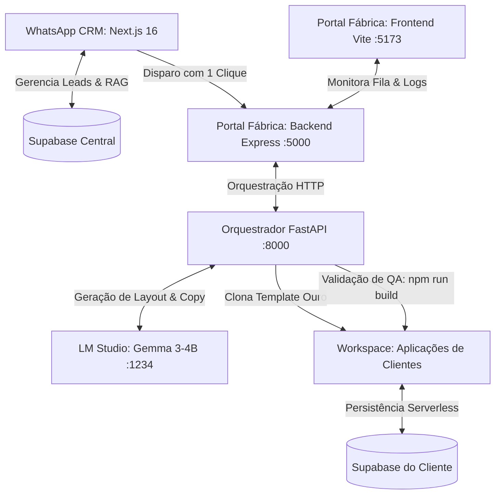

# 🚀 Fábrica de Software Autônoma com IA & CRM Integrado

Ecossistema completo e automatizado para **captação de leads via WhatsApp CRM**, **análise de contexto com RAG**, e **geração 100% autônoma de aplicações web e PWAs** adaptadas ao nicho de cada cliente.

O sistema opera com uma equipe de agentes de inteligência artificial construídos sobre **LangGraph** (com autorrecuperação cíclica e validação de QA com build real), suporte nativo a **LLMs Locais via LM Studio (Google Gemma)** ou nuvem, e persistência serverless via **Supabase**.

---

## 🗺️ Arquitetura do Ecossistema



---

## ✨ Pilares e Funcionalidades

### 1. 🤖 Orquestrador de Agentes de IA (LangGraph + FastAPI)
Fluxo cíclico com autorrecuperação que transforma um briefing em uma aplicação completa:
* **Analista de Requisitos (`requirements_analyst_node`)**: Analisa o lead, mensagens e links (Instagram/Site) via LLM ou RAG para extrair nicho, nome, paleta de cores e serviços essenciais.
* **Clonador de Infraestrutura (`infra_cloner_node`)**: Clona fisicamente a base do `gold_templates/template_base_app` para a pasta do cliente em `workspace/<nome_do_app>`.
* **Desenvolvedor / Injetor (`code_injector_node`)**:
  * Gera a **`LandingPage.jsx` sob medida** em 5 seções estruturadas via LLM local (LM Studio);
  * Injeta a identidade visual no `index.css` (`:root` `--primary-color`, `--bg-color`);
  * Atualiza o `ai_config.json` e o título do `index.html`;
  * Copia o schema estável e padronizado do banco para `database/base_schema.sql`.
* **Validador de QA (`qa_validator_node`)**: Executa `npm run build` real no projeto compilado. Se houver falha sintática, retroalimenta o Desenvolvedor para correção automática (até 3 tentativas).

### 2. 🧠 Suporte Nativo a LLM Local (LM Studio) & Nuvem
* **Execução 100% Local**: Conecta-se diretamente ao LM Studio (`http://127.0.0.1:1234/v1`) utilizando o modelo **`google/gemma-3-4b`** (ou modelos compatíveis).
* **Timeout Resiliente**: Configurado com 120s de tolerância para modelos locais em GPU/CPU.
* **Fallback Inteligente**: Se a LLM local ou a nuvem estiverem indisponíveis, o sistema aciona um motor heurístico com fotos temáticas do Unsplash que garante que o projeto nunca fique quebrado.

### 3. 🎨 Frontend Adaptado ao Nicho (Experiência Comercial)
* **Rota Raiz (`/`)**: Apresenta uma **Landing Page completa e profissional**, dividida em 5 blocos:
  1. **Navbar**: Logotipo, nome comercial e botão direto "Agendar Horário";
  2. **Hero Section**: Headline de alto impacto do nicho, proposta de valor humanizada (sem clichês de IA), botão CTA e foto temática do Unsplash;
  3. **Vitrine de Diferenciais & Serviços**: 3 cards com fotos reais em alta resolução do Unsplash, descrição e preços;
  4. **Informações Locais**: Endereço, horários de atendimento e telefone/WhatsApp extraídos do lead;
  5. **Footer**: Rodapé institucional com CTA para reserva.
* **Rota de Agendamento (`/agendar`)**: Formulário intuitivo e dinâmico de reserva de vagas e horários (`BookingPage`).
* **Painel Administrativo (`/admin`)**: Gestão de horários, vagas e configurações da agenda.

### 4. 🗄️ Backend Padronizado & Geral (Supabase Serverless)
* **Base Idempotente**: A pasta `database/` de cada cliente recebe o `base_schema.sql` oficial e limpo, sem alucinações de SQL e **sem dados falsos/mock**.
* **Tabelas Prontas**: `agendamentos`, `configuracao_agenda` e publicação Realtime habilitada.
* **Escalabilidade**: A base é estável para qualquer segmento e pode receber extensões pontuais conforme as demandas do negócio.

### 5. 📱 WhatsApp CRM (Next.js 16 Turbopack)
* Painel completo de gestão de contatos, funis de vendas (*Deals*) e histórico de conversas.
* Integração direta com a Fábrica: botão **"Iniciar Geração do PWA (IA)"** no sidebar do contato para disparar a automação instantaneamente.

---

## 🛠️ Stack Tecnológica

| Camada | Tecnologias |
| :--- | :--- |
| **WhatsApp CRM** | Next.js 16 (Turbopack, App Router), React 19, Tailwind CSS, Shadcn UI |
| **Fábrica de IA** | Python 3.10+, FastAPI, LangGraph, LangChain, Uvicorn, HTTPX |
| **Modelos de IA** | LM Studio Local (`google/gemma-3-4b`) + fallback Google Gemini / OpenAI |
| **Portal Fábrica** | React (Vite 5), Tailwind CSS, Node.js / Express |
| **Projetos de Clientes** | PWA React + Vite, Tailwind CSS, Supabase JS (Serverless) |
| **Banco de Dados** | Supabase (PostgreSQL + RLS + Realtime) |

---

## 📁 Estrutura do Repositório

```text
full_stack/
├── main.py                  # Ponto de entrada do Orquestrador FastAPI (porta 8000)
├── requirements.txt         # Dependências Python (FastAPI, LangGraph, etc.)
├── COMO_RODAR.md            # Guia prático de comandos e credenciais
├── README.md                # Apresentação do projeto e arquitetura
├── ai_software_factory/     # Núcleo da IA: agentes, estado, prompts e RAG
│   ├── agents.py            # Grafo de agentes (Analista, Cloner, Dev, QA)
│   ├── main.py              # API FastAPI (/processar-fila, /gerar-site)
│   └── .env                 # Chaves de API e USE_LOCAL_LLM=true
├── gold_templates/          # Templates Ouro usados como matriz de clonagem
│   └── template_base_app/   # Base PWA React + Vite + Supabase
├── wacrm/                   # Aplicação Next.js 16 do WhatsApp CRM (porta 3000)
└── workspace/               # Portais e diretório dos clientes gerados
    ├── portal_fabrica/      # Dashboard de acompanhamento (porta 5173 / 5000)
    ├── Marcianos/           # Exemplo: Hamburgueria / Rodízio
    ├── barbearia_dom_lucas/ # Exemplo: Barbearia gerada via Gemma no LM Studio
    └── campeiro_fogo/       # Exemplo: Restaurante campeiro
```

---

## 🚀 Como Rodar o Ecossistema

Consulte o documento completo em [COMO_RODAR.md](COMO_RODAR.md) para detalhes adicionais.

### 🌐 Portas e Serviços Locais

| Serviço | URL | Descrição |
| :--- | :--- | :--- |
| **LM Studio** | `http://127.0.0.1:1234` | Servidor local com modelo `google/gemma-3-4b` |
| **WhatsApp CRM** | [http://localhost:3000](http://localhost:3000) | Gestão de leads e disparo de geração (`admin@wacrm.com` / `mano018`) |
| **Portal Fábrica (Backend)** | [http://localhost:5000](http://localhost:5000) | API Express intermediadora de fila e Supabase |
| **Portal Fábrica (Frontend)** | [http://localhost:5173](http://localhost:5173) | Dashboard de monitoramento em tempo real |
| **Orquestrador de IA** | [http://localhost:8000/docs](http://localhost:8000/docs) | API FastAPI dos agentes com Swagger interativo |
| **Site de Cliente (Exemplo)** | [http://localhost:5174](http://localhost:5174) | Aplicação PWA compilada do cliente |

---

### 💻 Comandos de Inicialização (Terminais Separados)

1. **LM Studio (Modelo Local)**:
   * Abra o LM Studio, carregue o modelo `google/gemma-3-4b`, acesse **Developer / Local Server** e inicie o servidor na porta `1234`.

2. **Orquestrador de IA (FastAPI)** — `http://localhost:8000`:
   ```powershell
   .venv\Scripts\activate
   python main.py
   ```

3. **Backend do Portal Fábrica (Express)** — `http://localhost:5000`:
   ```powershell
   cd workspace/portal_fabrica/backend
   npm run dev
   ```

4. **Frontend do Portal Fábrica (Vite)** — `http://localhost:5173`:
   ```powershell
   cd workspace/portal_fabrica
   npm run dev
   ```

5. **WhatsApp CRM (Next.js)** — `http://localhost:3000`:
   ```powershell
   cd wacrm
   npm run dev
   ```

6. **Visualizar um Site de Cliente (Ex: Barbearia Dom Lucas)**:
   ```powershell
   cd workspace/barbearia_dom_lucas/frontend
   npm run dev
   ```