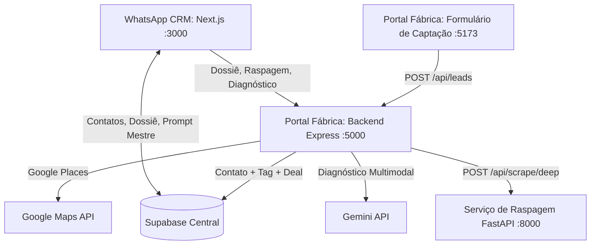

# 🚀 Fábrica de Software com IA & CRM Integrado

Ecossistema para **captar leads**, **coletar e enriquecer dados do negócio** (Google Maps, raspagem do site, diagnóstico com IA) e **gerar o Prompt Mestre**, que o operador copia para uma IA externa (Claude, ChatGPT, v0, Gemini) construir o site do cliente do zero.

O app **não gera sites**: o pipeline termina no Prompt Mestre ([ADR 0011](docs/adr/0011-remove-autonomous-generation-stack.md)).

> 📚 **Documentação Complementar**:
> - [Guia de Inicialização (Como Rodar)](docs/como-rodar.md)
> - [Especificação Técnica de Arquitetura](docs/architecture.md)
> - [Glossário de Domínio](GLOSSARY.md)
> - [Registros de Decisões de Arquitetura (ADRs)](docs/adr/)

---

## 🗺️ Arquitetura



## 🔁 Do Lead ao Prompt Mestre

1. **Lead Briefing**: o formulário do Portal envia nome, empresa (opcional), e-mail, WhatsApp e site para `POST /api/leads`. O backend cria ou atualiza o Contato no CRM, aplica a tag "Fábrica de Sites" e abre um Deal no funil, sem criar conversa no Inbox.
2. **Decision Gate**: no CRM, o operador analisa o lead e decide gerar o Prompt Mestre ou desqualificá-lo.
3. **Lead Dossier**: consulta ao Google Places com fotos (até 6, classificadas em cardápio ou ambiente), avaliações 5 estrelas e negativas, horários, modalidades de atendimento, telefone verificado, comodidades, links na web e uma sugestão de pitch comercial.
4. **Raspagem Profunda**: o serviço Python extrai cardápio, preços, textos institucionais e Markdown dos sites do lead com Scrapling.
5. **Diagnóstico Multimodal**: o Gemini analisa fotos e textos e descreve a empresa, o estilo visual, o público e os diferenciais.
6. **Prompt Mestre**: no perfil do lead (`/contacts/[id]`), o operador revisa, edita e copia o prompt ("Copiar Prompt Mestre para a IA").

Tudo fica salvo em `contacts.additional_data` (`dossie`, `scraped_data`, `diagnostico_ia`, `prompt_mestre`).

---

## 🧩 Componentes

| Componente | Pasta | Porta | Papel |
| :--- | :--- | :--- | :--- |
| **WhatsApp CRM** | `wacrm/` | 3000 | Inbox compartilhado, contatos, funis, broadcasts, automações e flows; perfil do lead com Dossiê, raspagem, diagnóstico e Prompt Mestre. Baseado no template open source [ArnasDon/wacrm](https://github.com/ArnasDon/wacrm) |
| **Portal Fábrica (Frontend)** | `workspace/portal_fabrica/` | 5173 | Formulário público de captação de leads |
| **Portal Fábrica (Backend)** | `workspace/portal_fabrica/backend/` | 5000 | Captação, Google Places, raspagem e Diagnóstico Multimodal |
| **Serviço de Raspagem** | `ai_software_factory/` | 8000 | FastAPI com uma única rota, `POST /api/scrape/deep` |
| **Sites de Clientes** | `workspace/<cliente>/` | 5174+ | Sites entregues, construídos fora do app a partir do Prompt Mestre |

### Rotas do backend do Portal

| Rota | Função |
| :--- | :--- |
| `POST /api/leads` | Captação do Lead Briefing |
| `POST /api/dossie/consultar` | Consulta direta ao Google Places |
| `POST /api/leads/:id/enrich-dossier` | Gera e salva o Lead Dossier |
| `POST /api/leads/:id/scrape-deep` | Raspagem profunda e salvamento dos dados raspados |
| `POST /api/leads/:id/diagnose` | Diagnóstico Multimodal e Prompt Mestre |
| `POST /api/upload` | Upload de arquivos do lead |
| `GET /api/health` | Saúde do serviço e status do Supabase |

`:id` é sempre o id do contato em `contacts`.

---

## 🛠️ Stack Tecnológica

| Camada | Tecnologias |
| :--- | :--- |
| **WhatsApp CRM** | Next.js 16 (App Router), React 19, Tailwind CSS 4, Shadcn UI, Vitest |
| **Portal Fábrica (Frontend)** | React 18, Vite 5, Tailwind CSS 4, React Router 7 |
| **Portal Fábrica (Backend)** | Node.js 20+, Express 4, `node:test` |
| **Serviço de Raspagem** | Python 3.10+, FastAPI, Uvicorn, Scrapling, Pytest |
| **IA e dados externos** | Google Places API, Google Gemini |
| **Banco de Dados** | Supabase (PostgreSQL + Auth + RLS + Realtime) |

---

## 📁 Estrutura do Repositório

```text
full_stack/
├── main.py                  # Sobe o serviço de raspagem (porta 8000)
├── requirements.txt         # Dependências Python
├── rodar_apps.ps1 / .bat    # Sobe todos os serviços em terminais separados
├── ai_software_factory/     # Serviço de raspagem (FastAPI + Scrapling)
│   ├── main.py              # POST /api/scrape/deep
│   ├── scraper_service.py   # Cardápio, preços, textos institucionais e Markdown
│   └── tests/
├── wacrm/                   # WhatsApp CRM (Next.js) + migrations do Supabase
├── workspace/
│   ├── portal_fabrica/      # Formulário de captação + backend Express
│   ├── 20barranove/         # Sites de clientes entregues
│   ├── AppCustomizado/
│   ├── Marcianos/
│   ├── campeiro_fogo/
│   └── pizzaria_nonna/
├── docs/                    # Arquitetura, guia de execução e ADRs
└── GLOSSARY.md              # Glossário de domínio
```

---

## 🚀 Como Rodar

### Pré-requisitos

- Python 3.10+ com um ambiente virtual em `.venv` na raiz
- Node.js 20+ e npm
- Um projeto Supabase com as migrations de `wacrm/supabase/migrations`

### Variáveis de ambiente

| Arquivo | Variáveis |
| :--- | :--- |
| `wacrm/.env.local` (modelo em `.env.local.example`) | `NEXT_PUBLIC_SUPABASE_URL`, `NEXT_PUBLIC_SUPABASE_ANON_KEY`, `SUPABASE_SERVICE_ROLE_KEY`, `ENCRYPTION_KEY`, `META_APP_SECRET`, `NEXT_PUBLIC_SITE_URL` |
| `workspace/portal_fabrica/backend/.env` | `SUPABASE_URL`, `SUPABASE_SERVICE_ROLE_KEY`, `GOOGLE_MAPS_API_KEY`, `GEMINI_API_KEY` (opcional: `GEMINI_MODEL`, `AI_FACTORY_URL`, `PORT`) |

O backend do Portal também lê `wacrm/.env.local` e o `.env` da raiz como reserva.

### Tudo de uma vez (Windows)

```powershell
.\rodar_apps.ps1
```

O script sobe o serviço de raspagem, o Portal (backend e frontend), o CRM e os sites de clientes `campeiro_fogo` (5174) e `20barranove` (5175).

### Um serviço por terminal

```powershell
# Serviço de raspagem — http://localhost:8000/docs
.venv\Scripts\activate
pip install -r requirements.txt
python main.py

# Backend do Portal — http://localhost:5000
cd workspace/portal_fabrica/backend
npm install
npm run dev

# Formulário de captação — http://localhost:5173
cd workspace/portal_fabrica
npm install
npm run dev

# WhatsApp CRM — http://localhost:3000
cd wacrm
npm install
npm run dev
```

Para entrar no CRM, crie um usuário em `/signup` ou pelo painel de Auth do Supabase. A captação do Portal associa os leads à conta do usuário `admin@wacrm.com` ou, se ele não existir, ao primeiro perfil encontrado.

---

## 🧪 Testes

```powershell
# Serviço de raspagem
.venv\Scripts\python -m pytest ai_software_factory/tests

# Backend do Portal (usa um Supabase em memória e não toca no banco real)
cd workspace/portal_fabrica/backend
npm test

# Frontend do Portal (rodar da raiz do repositório)
node --test workspace/portal_fabrica/src/lib/api.test.mjs

# CRM
cd wacrm
npx vitest run
```
