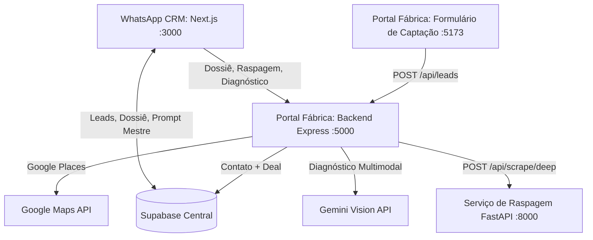

# 🚀 Fábrica de Software com IA & CRM Integrado

Ecossistema para **captação de leads via WhatsApp CRM**, **coleta e enriquecimento de dados do negócio** e **geração do Prompt Mestre** que o operador executa numa IA de fronteira externa (Claude, ChatGPT, v0, Gemini) para construir o site do cliente do zero.

O app **não gera sites**: o pipeline termina no Prompt Mestre (ver [ADR 0011](docs/adr/0011-remove-autonomous-generation-stack.md)).

> 📚 **Documentação Complementar**:
> - [Guia Detalhado de Inicialização (Como Rodar)](docs/como-rodar.md)
> - [Especificação Técnica de Arquitetura](docs/architecture.md)
> - [Glossário de Domínio Canônico](GLOSSARY.md)
> - [Registros de Decisões de Arquitetura (ADRs)](docs/adr/)

---

## 🗺️ Arquitetura do Ecossistema



## 🔁 Fluxo

1. **Lead Briefing**: o formulário do Portal envia nome, empresa, e-mail, WhatsApp e site para `POST /api/leads`, que cria o Contato e o Deal no CRM.
2. **Lead Dossier**: o CRM consulta o Google Places (fotos, avaliações, horários, modalidades de atendimento).
3. **Raspagem Profunda**: o serviço Python extrai cardápio, preços e textos institucionais com Scrapling.
4. **Diagnóstico Multimodal**: o Gemini Vision analisa fotos e textos e descreve a empresa, o estilo visual, o público e os diferenciais.
5. **Prompt Mestre**: no perfil do lead (`/contacts/[id]`) o operador revisa, edita e copia o prompt para executar numa IA externa.

---

## 🛠️ Stack Tecnológica

| Camada | Tecnologias |
| :--- | :--- |
| **WhatsApp CRM** | Next.js 16 (App Router), React 19, Tailwind CSS, Shadcn UI |
| **Portal Fábrica** | React (Vite 5), Tailwind CSS, Node.js / Express |
| **Serviço de Raspagem** | Python 3.10+, FastAPI, Uvicorn, Scrapling |
| **IA** | Google Gemini (Diagnóstico Multimodal) |
| **Banco de Dados** | Supabase (PostgreSQL + RLS + Realtime) |

---

## 📁 Estrutura do Repositório

```text
full_stack/
├── main.py                  # Ponto de entrada do serviço de raspagem (porta 8000)
├── requirements.txt         # Dependências Python
├── ai_software_factory/     # Serviço de raspagem profunda (FastAPI + Scrapling)
│   ├── main.py              # API FastAPI (POST /api/scrape/deep)
│   └── scraper_service.py   # Extração de cardápio, preços e textos institucionais
├── wacrm/                   # WhatsApp CRM em Next.js (porta 3000)
└── workspace/
    ├── portal_fabrica/      # Formulário de captação (5173) e backend Express (5000)
    └── <cliente>/           # Sites de clientes entregues (Tenant Workspaces)
```

---

## 🚀 Como Rodar o Ecossistema

### 🌐 Portas e Serviços Locais

| Serviço | URL | Descrição |
| :--- | :--- | :--- |
| **WhatsApp CRM** | [http://localhost:3000](http://localhost:3000) | Gestão de leads, Dossiê e Prompt Mestre (`admin@wacrm.com` / `mano018`) |
| **Portal Fábrica (Backend)** | [http://localhost:5000](http://localhost:5000) | API de captação, Dossiê, raspagem e diagnóstico |
| **Portal Fábrica (Frontend)** | [http://localhost:5173](http://localhost:5173) | Formulário público de captação de leads |
| **Serviço de Raspagem** | [http://localhost:8000/docs](http://localhost:8000/docs) | FastAPI com Swagger interativo |

### 💻 Comandos de Inicialização (Terminais Separados)

1. **Serviço de Raspagem (FastAPI)** — `http://localhost:8000`:
   ```powershell
   .venv\Scripts\activate
   pip install -r requirements.txt
   python main.py
   ```

2. **Backend do Portal Fábrica (Express)** — `http://localhost:5000`:
   ```powershell
   cd workspace/portal_fabrica/backend
   npm run dev
   ```

3. **Frontend do Portal Fábrica (Vite)** — `http://localhost:5173`:
   ```powershell
   cd workspace/portal_fabrica
   npm run dev
   ```

4. **WhatsApp CRM (Next.js)** — `http://localhost:3000`:
   ```powershell
   cd wacrm
   npm run dev
   ```
