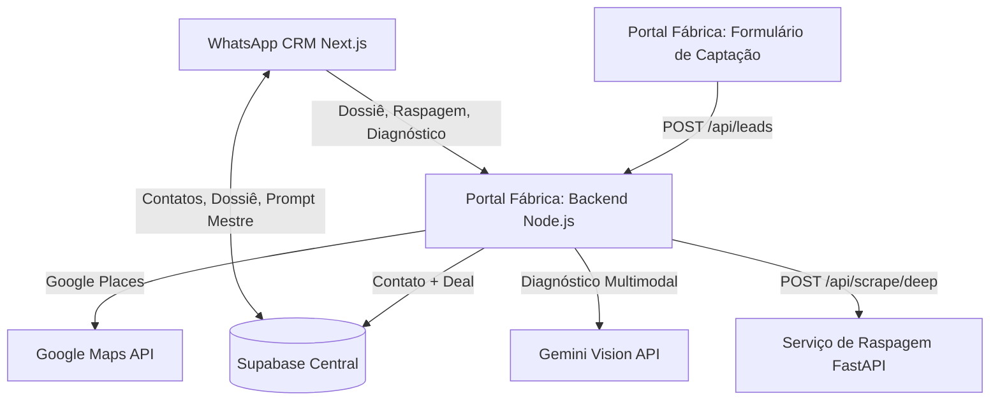

# Especificação Técnica: Fábrica de Prompts & CRM

Este documento descreve a arquitetura, a estrutura de dados e o fluxo do ecossistema: **WhatsApp CRM (wacrm)**, **Portal Fábrica** e **Serviço de Raspagem**. O app coleta e enriquece dados do lead e termina no **Prompt Mestre**; o site do cliente é construído fora do app, numa IA externa (ver [ADR 0011](adr/0011-remove-autonomous-generation-stack.md)).

---

## 1. Visão Geral do Ecossistema



1. **Formulário de Captação (React/Vite)**: página pública onde o lead informa nome, empresa, e-mail, WhatsApp e site (o Lead Briefing).
2. **Portal Fábrica Backend (Express)**: registra o lead como Contato e Deal no CRM e expõe as rotas de Dossiê, raspagem e diagnóstico.
3. **Serviço de Raspagem (FastAPI + Scrapling)**: extrai cardápio, preços, textos institucionais e Markdown dos sites do lead.
4. **WhatsApp CRM (Next.js)**: painel interno onde o operador passa pelo Decision Gate, revisa o Dossiê e o Diagnóstico e gera, edita e copia o Prompt Mestre no perfil do lead (`/contacts/[id]`).

---

## 2. Rotas do Backend do Portal (porta `5000`)

| Rota | Função |
| :--- | :--- |
| `POST /api/leads` | Captação: cria ou atualiza o Contato, a tag "Fábrica de Sites" e o Deal |
| `POST /api/dossie/consultar` | Consulta direta ao Google Places |
| `POST /api/leads/:id/enrich-dossier` | Gera o Lead Dossier e salva em `contacts.additional_data.dossie` |
| `POST /api/leads/:id/scrape-deep` | Chama o serviço de raspagem e salva em `contacts.additional_data.scraped_data` |
| `POST /api/leads/:id/diagnose` | Diagnóstico Multimodal (Gemini) e Prompt Mestre, salvos em `contacts.additional_data` |
| `POST /api/upload` | Upload de arquivos do lead (Supabase Storage ou disco local) |
| `GET /api/health` | Saúde do serviço e status do Supabase |

`:id` é sempre o id do contato em `contacts`.

---

## 3. Dados

Tudo o que o pipeline produz vive no contato:

| Campo | Conteúdo |
| :--- | :--- |
| `contacts.additional_data.links` | Links do lead (site oficial, Maps, redes) |
| `contacts.additional_data.dossie` | Lead Dossier do Google Places |
| `contacts.additional_data.scraped_data` | Dados Raspados do Estabelecimento |
| `contacts.additional_data.diagnostico_ia` | Diagnóstico Multimodal |
| `contacts.additional_data.prompt_mestre` | Prompt Mestre editável |

A tabela `fila_projetos` não é mais usada e ainda não foi removida do banco.

---

## 4. Estrutura de Diretórios

```text
full_stack/
├── main.py                  # Ponto de entrada do serviço de raspagem
├── ai_software_factory/     # FastAPI + Scrapling (POST /api/scrape/deep)
├── wacrm/                   # WhatsApp CRM (Next.js)
├── workspace/
│   ├── portal_fabrica/      # Formulário de captação + backend Express
│   └── <cliente>/           # Sites de clientes entregues (Tenant Workspaces)
├── docs/                    # Arquitetura, guia de execução e ADRs
└── GLOSSARY.md              # Glossário de domínio
```
