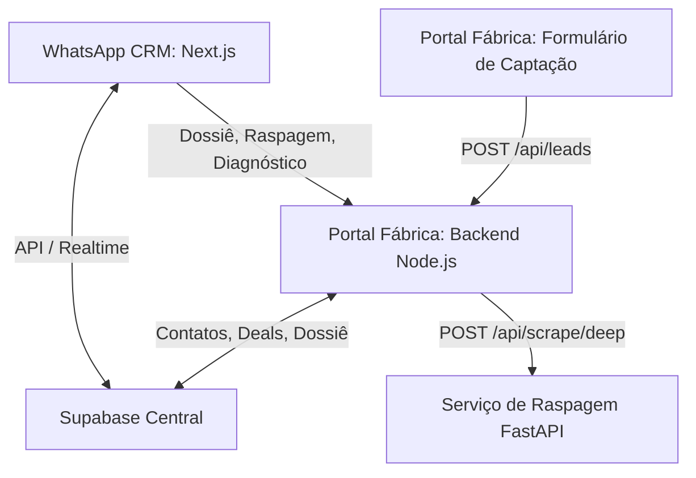

# Guia de Inicialização do Workspace - Fábrica de Software com IA

Este documento orienta sobre como rodar e testar os componentes do ecossistema: o **WhatsApp CRM**, o **Portal Fábrica** (formulário de captação e backend), o **Serviço de Raspagem** e os **sites de clientes entregues** (como `Marcianos`, `20barranove`, `campeiro_fogo`).

> [!TIP]
> **Inicialização Rápida com 1 Clique**:
> Para iniciar todos os serviços em terminais dedicados no Windows, rode na raiz:
> ```powershell
> .\rodar_apps.ps1
> ```
> ou via arquivo em lote:
> ```cmd
> rodar_apps.bat
> ```

---

## 1. Visão Geral dos Componentes



1. **WhatsApp CRM (Next.js)**: painel para qualificar leads, consultar o Lead Dossier, rodar a raspagem e o Diagnóstico Multimodal e gerar o Prompt Mestre.
2. **Portal Fábrica (Backend Node.js & Frontend React/Vite)**: o frontend é o formulário público de captação; o backend registra o lead no CRM e expõe as rotas de Dossiê, raspagem e diagnóstico.
3. **Serviço de Raspagem (Python FastAPI)**: extrai cardápio, preços e textos institucionais dos sites do lead com Scrapling.
4. **Sites de Clientes**: sites entregues, construídos fora do app a partir do Prompt Mestre, sob a pasta `workspace/`.

---

## 2. Pré-requisitos Gerais

* **Python 3.10+** (com um ambiente virtual criado na pasta `.venv` da raiz).
* **Node.js (versão 20+)** e **npm** instalados.
* Um terminal PowerShell ou Git Bash aberto no diretório raiz do projeto.
* Chaves `GOOGLE_MAPS_API_KEY` e `GEMINI_API_KEY` para o Dossiê e o Diagnóstico Multimodal.

---

## 3. Como Rodar Manualmente

### Passo 3.1: Serviço de Raspagem (FastAPI / Python) — porta `8000`

```powershell
.venv\Scripts\activate
pip install -r requirements.txt
python main.py
```

* Documentação interativa: `http://localhost:8000/docs`
* Configuração de ambiente em: `ai_software_factory/.env`

### Passo 3.2: Backend do Portal Fábrica (Node.js) — porta `5000`

```powershell
cd workspace\portal_fabrica\backend
npm install
npm run dev
```

* Configurações em: `workspace/portal_fabrica/backend/.env` (`AI_FACTORY_URL` aponta para o serviço de raspagem).

### Passo 3.3: Frontend do Portal Fábrica (Vite / React) — porta `5173`

```powershell
cd workspace\portal_fabrica
npm install
npm run dev
```

### Passo 3.4: WhatsApp CRM (wacrm) — porta `3000`

```powershell
cd wacrm
npm run dev
```

* As configurações de ambiente ficam em `wacrm/.env.local`.

---

## 4. Do Lead ao Prompt Mestre

1. O lead preenche o formulário do Portal (`http://localhost:5173`) ou é cadastrado direto no CRM.
2. No CRM, abra **Contacts** e clique no lead para ir ao perfil (`/contacts/[id]`).
3. Consulte o **Dossiê do Google Maps**, rode a **Raspagem Profunda** e gere o **Diagnóstico da IA**.
4. Revise e edite o **Prompt Mestre** e copie-o para a IA de sua preferência.

---

## 5. Como Rodar os Sites de Clientes

```powershell
cd workspace\Marcianos\frontend
npm install
npm run dev
```

---

## 6. Testes

```powershell
# Serviço de raspagem
.venv\Scripts\python -m pytest ai_software_factory/tests

# Backend do Portal (usa um Supabase em memória; não toca no banco real)
cd workspace\portal_fabrica\backend
npm test

# CRM
cd wacrm
npx vitest run
```
