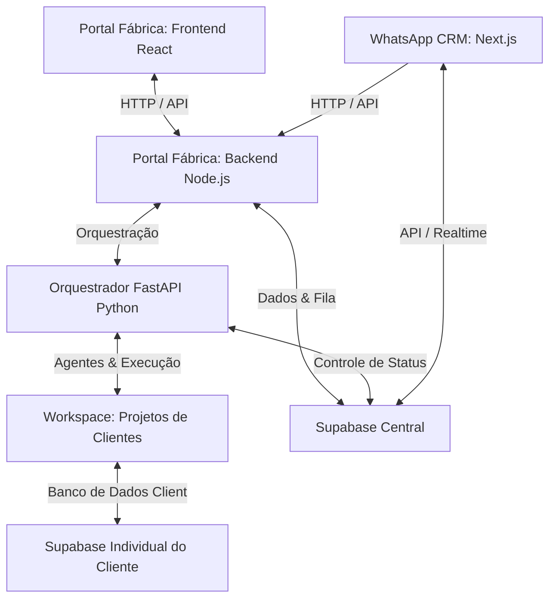

# Guia de Inicialização do Workspace - Fábrica de Software com IA

Este documento orienta sobre como rodar e testar todos os componentes do ecossistema, incluindo o **Orquestrador de Fábrica de IA**, o **Portal Fábrica**, o **WhatsApp CRM** e os **Projetos de Clientes** (como `Marcianos`, `20barranove`, `campeiro_fogo`).

> [!TIP]
> **Inicialização Rápida com 1 Clique**:
> Para iniciar todos os 6 serviços simultaneamente em terminais dedicados no Windows, basta rodar o script PowerShell na raiz:
> ```powershell
> .\rodar_apps.ps1
> ```
> ou via arquivo em lote:
> ```cmd
> rodar_apps.bat
> ```

---

## 1. Visão Geral dos Componentes

O repositório é composto por quatro tipos principais de aplicações:



1. **Orquestrador Backend (Python FastAPI - LangGraph)**: Responsável por rodar o grafo de agentes de IA para criar e validar projetos a partir de especificações.
2. **Portal Fábrica (Backend Node.js & Frontend React/Vite)**: O dashboard que gerencia a fila de projetos e exibe os resultados da automação de software.
3. **Projetos de Clientes (Frontend React + Backend Serverless Supabase)**: Os websites/aplicações finais gerados pela fábrica que ficam sob a pasta `workspace/`.
4. **WhatsApp CRM (Next.js)**: Painel CRM para visualizar/qualificar leads do WhatsApp e disparar a geração de sites através da Fábrica de IA.

---

## 2. Pré-requisitos Gerais

Antes de iniciar qualquer projeto, certifique-se de possuir:
* **Python 3.10+** (com um ambiente virtual criado na pasta `.venv` da raiz).
* **Node.js (versão 18+)** e **npm** instalados.
* Um terminal Powershell ou Git Bash aberto no diretório raiz do projeto.

---

## 3. Como Rodar o Portal Fábrica Manualmente

Para ter o sistema completo de geração de projetos funcionando, você pode iniciar 3 processos (de preferência em terminais separados).

### Passo 3.1: Iniciar o Orquestrador Backend (FastAPI / Python)
Este backend roda o fluxo dos agentes (Analista, Cloner, Desenvolvedor e QA) e escuta na porta `8000`.

1. Abra um terminal na raiz do projeto.
2. Ative o ambiente virtual Python e instale as dependências caso ainda não tenha feito:
   ```powershell
   .venv\Scripts\activate
   pip install -r requirements.txt
   ```
3. Inicie o servidor FastAPI:
   ```powershell
   python main.py
   ```
   * O servidor estará disponível em: `http://localhost:8000`
   * Configuração de chaves de API / LLM em: `ai_software_factory/.env`

---

### Passo 3.2: Iniciar o Backend do Portal Fábrica (Node.js)
Este backend intermedia as requisições do frontend da fábrica, conecta-se à fila do Supabase e aciona o orquestrador Python.

1. Abra um novo terminal no diretório do backend do portal:
   ```powershell
   cd workspace\portal_fabrica\backend
   ```
2. Instale as dependências (se for a primeira vez):
   ```powershell
   npm install
   ```
3. Inicie o servidor em modo de desenvolvimento:
   ```powershell
   npm run dev
   ```
   * O servidor backend do portal rodará na porta `5000` (`http://localhost:5000`).
   * Configurações de acesso e URLs em: `workspace/portal_fabrica/backend/.env`

---

### Passo 3.3: Iniciar o Frontend do Portal Fábrica (Vite / React)
Esta é a interface web para gerenciar e simular a criação de novos sites.

1. Abra um novo terminal no diretório raiz do portal:
   ```powershell
   cd workspace\portal_fabrica
   ```
2. Instale as dependências:
   ```powershell
   npm install
   ```
3. Inicie o servidor frontend:
   ```powershell
   npm run dev
   ```
   * O frontend abrirá no navegador, geralmente em: `http://localhost:5173`

---

## 4. Como Rodar os Projetos dos Clientes

Os projetos de clientes gerados pela fábrica estão localizados na pasta `workspace/` (ex: `workspace/Marcianos`, `workspace/20barranove`, `workspace/campeiro_fogo`). Eles não possuem um backend próprio escrito em Node ou Python; em vez disso, são **Serverless**, conectando-se diretamente ao **Supabase**.

Para executar o frontend de um cliente localmente:

1. Acesse a pasta frontend do cliente específico:
   ```powershell
   cd workspace\Marcianos\frontend
   ```
2. Instale as dependências (se necessário):
   ```powershell
   npm install
   ```
3. Execute o servidor de desenvolvimento Vite:
   ```powershell
   npm run dev
   ```
   * O app do cliente estará ativo em uma porta local, por exemplo `http://localhost:5174` (ou a próxima disponível).

---

## 5. Como Rodar o WhatsApp CRM (wacrm)

Este painel do CRM gerencia os seus contatos e leads qualificados e integra o fluxo de geração de sites por IA.

### Passo 5.1: Iniciar o Servidor do CRM
1. Abra um terminal na pasta do CRM:
   ```powershell
   cd wacrm
   ```
2. Inicie o servidor de desenvolvimento:
   ```powershell
   npm run dev
   ```
   * O CRM estará disponível localmente em: `http://localhost:3000`
   * As configurações de ambiente já estão prontas no arquivo `wacrm/.env.local`.

### Passo 5.2: Disparar a IA a partir do CRM
1. Acesse o menu **Contacts** no CRM (`http://localhost:3000/contacts`).
2. Crie ou selecione um contato, defina suas informações e, na aba **Details**, clique no botão **Gerar Site com IA**.
3. O CRM enviará os dados do cliente para a API da Fábrica (`http://localhost:5000/api/projetos`) e disparará o processamento em segundo plano.

---

## 6. Como Executar Testes Rápidos e Simulações

Além de usar o Portal Fábrica, você pode testar componentes específicos diretamente pela linha de comando:

### Teste de Refinamento do Time de Desenvolvimento (Passe 3)
Para testar a atuação direta dos agentes desenvolvendo uma feature (ex: criação de uma Sidebar elegante):

1. Ative seu ambiente virtual na raiz do projeto.
2. Execute o script Python localizado em `tests/`:
   ```powershell
   python tests/manual_test_dev_team.py
   ```
